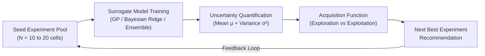

# BatteryMind — Small-Data Battery Performance Optimization using Active Learning
## Project Scope & Technical Foundation (Phase 0)

---

### 1. Problem Statement
Battery degradation and cycle-life testing is one of the most critical bottlenecks in clean energy, electric mobility, and consumer electronics. Evaluating the longevity and performance of a new lithium-ion battery design or charging protocol in a laboratory setting can take **months to years** per cell across hundreds or thousands of charge-discharge cycles. 

Traditional machine learning approaches in battery informatics often assume the existence of large, pre-collected datasets ("Big Data"). In real-world research laboratories, however:
- Testing equipment (environmental chambers, multi-channel cyclers) is expensive and limited in capacity.
- Collecting massive experimental datasets is economically and temporally infeasible.
- Engineers must make high-stakes decisions about **which experiment to run next** based on only a handful of completed tests.

**The core challenge:** How can we accurately predict battery performance and guide experimental campaigns using a **small set of initial experiments**, systematically prioritizing which battery condition to test next to maximize discovery speed and minimize wasted testing time?

---

### 2. Project Objective
**BatteryMind** aims to build a research-oriented, accessible, and reproducible machine learning pipeline that uses limited battery experimental data to:
1. Learn degradation and performance patterns from small sample sizes ($N \le 25$).
2. Provide calibrated prediction uncertainty estimates alongside performance predictions.
3. Quantify the information value of un-tested candidate experimental conditions.
4. Select and recommend the **"Next Best Experiment"** using Active Learning / Bayesian Optimization acquisition strategies.

---

### 3. Target Variable
The primary target variable is:
- **Battery Cycle Life ($y$):** The total number of completed cycles before a battery cell's discharge capacity degrades to 80% of its nominal rated capacity (the standard end-of-life / EOL criterion in battery research).

*Secondary / Alternative Formulation (for Phase 2+ exploration):*
- **Discharge Capacity Fade Rate:** Capacity retention after fixed cycle intervals (e.g., at Cycle 100 or Cycle 500).

---

### 4. Input Features
To ensure the project remains practical, interpretable, and operable under small-data constraints, BatteryMind focuses on **cycle-level summary features** and **early-life degradation signatures** (within the first 5–100 cycles) rather than raw gigabytes of high-frequency time series:

1. **Experimental / Protocol Conditions:**
   - Charging Policy Parameters (e.g., initial charge current $C_1$, secondary charge current $C_2$, state-of-charge transition point $\%SOC$, total charge duration).
   - Operating Environment (e.g., ambient temperature, cutoff voltages).

2. **Early-Cycle Degradation Features:**
   - $\Delta Q_{100-10}(V)$ summary statistics: Difference in discharge capacity curves between cycle 100 and cycle 10 (variance, minimum, skewness, and mean).
   - Internal resistance ($IR$) change: Initial resistance and slope over early cycles ($\Delta IR_{100-10}$).
   - Thermal indicators: Average and maximum cell surface temperature during early cycling.
   - Early discharge capacity degradation slope: $\frac{d Q}{d n}$ over the first 50–100 cycles.

---

### 5. Expected ML Tasks
BatteryMind executes four tightly integrated ML tasks:

1. **Small-Sample Regression with Uncertainty Quantification:**
   - Train probabilistic surrogate models (e.g., Gaussian Process Regressors, Bayesian Ridge, or Quantile/Ensemble models) capable of outputting a predicted mean $\mu(x)$ and an epistemic uncertainty metric $\sigma(x)$ from 10–25 training samples.
2. **Early-Prediction Benchmark:**
   - Predict final cycle life using only early-cycle signatures, establishing a baseline error (RMSE, MAE, $R^2$) under small-data limits.
3. **Candidate Pool Scoring (Active Learning):**
   - Evaluate a pool of candidate experimental policies using acquisition functions that balance:
     - **Exploration:** High model uncertainty ($\sigma(x)$).
     - **Exploitation:** High predicted cycle life ($\mu(x)$).
4. **Iterative Active Learning Simulation (Offline Experiment Selection):**
   - Retrospectively simulate a sequential experimental campaign: sequentially selecting candidate cells from an unlabelled pool, revealing their true performance, retraining the model, and observing the rate of performance optimization and model convergence.

---

### 6. What "Small-Data" Means for BatteryMind
In generic ML, small-data often refers to hundreds or thousands of instances. For **BatteryMind**, "small-data" has a specific experimental meaning:
- **Sample Size ($N$):** An initial seed dataset of **10 to 25 battery cells / experimental runs**.
- **Data Regime:** The number of features ($D \approx 5\text{--}10$) is of comparable order to the sample size ($N \approx 15\text{--}25$).
- **Implication:** High-capacity deep neural networks (transformers, deep CNNs, LSTMs) will overfit severely. The project intentionally leverages models with strong inductive biases, calibrated priors, and analytical uncertainty estimates (Gaussian Processes, regularized linear models, small ensemble regressors).

---

### 7. What "Active Learning" Means in Our Implementation
In traditional ML, a model is trained passively on all available data at once. In BatteryMind:
- **Pool-Based Active Learning:** We treat the full benchmark dataset as a "universe" of possible experiments.
- **Label Masking:** Most cell outcomes (cycle life) are masked and held in an unlabelled "Candidate Experiment Pool".
- **Acquisition Policy:** An acquisition algorithm (e.g., Maximum Uncertainty / Uncertainty Sampling, Upper Confidence Bound [UCB], Expected Improvement [EI]) inspects the unlabelled candidates and calculates which experiment would provide the highest information gain or highest performance gain.
- **Virtual Experimentation:** When an experiment is selected, its ground-truth result is revealed ("synthetically run in the lab"), the training pool expands by 1, and the model updates its belief state.

---

### 8. What the "Next Best Experiment" Means
The "Next Best Experiment" is **not** simply the condition predicted to have the highest performance, nor is it purely a random pick. It represents the optimal choice under a formal decision criterion:
- **In Pure Active Learning (Exploration):** The candidate condition where the model is least confident ($\max \sigma(x)$), reducing future prediction error across the experimental design space as quickly as possible.
- **In Bayesian Optimization (Exploitation + Exploration):** The candidate condition that maximizes an acquisition function such as UCB ($\alpha(x) = \mu(x) + \kappa \sigma(x)$), finding battery protocols with long cycle life while avoiding getting trapped in local optima.

---

### 9. Project Limitations
- **Offline Retrospective Simulation:** Experiments are drawn from historical scientific datasets rather than triggering live physical laboratory hardware.
- **Summary Feature Dependence:** Relies on standardized summary features or early cycles rather than raw, noisy sensor streams at millisecond resolution.
- **Homogeneous Cell Chemistries:** Experimental campaigns in the chosen dataset focus on consistent cell models (e.g., commercial 18650 cylindrical cells) to isolate charging/operational variables without confounding chemistry shifts.

---

### 10. Explicitly OUT OF SCOPE
To maintain focus, scientific clarity, and practical execution, the following are strictly excluded:
- ❌ **Physical Electrochemical Modeling:** Finite element, Newman P2D, or atomic-level simulation (e.g., COMSOL, PyBaMM physics-solvers).
- ❌ **Embedded BMS Firmware / Real-Time Hardware Control:** No microcontrollers, CAN-bus integration, or physical cycler actuation.
- ❌ **Large Deep Learning Architectures:** No Large Language Models, Vision Transformers, or massive deep neural networks requiring distributed GPU clusters.
- ❌ **Generic Black-Box Prediction without Uncertainty:** Building a single XGBoost/LSTM model that only predicts a number without variance estimates and active learning is explicitly out of scope.
- ❌ **Web Scraping or Uncurated Multi-Source Merging:** No ad-hoc scraping of inconsistent manufacturer datasheets.
