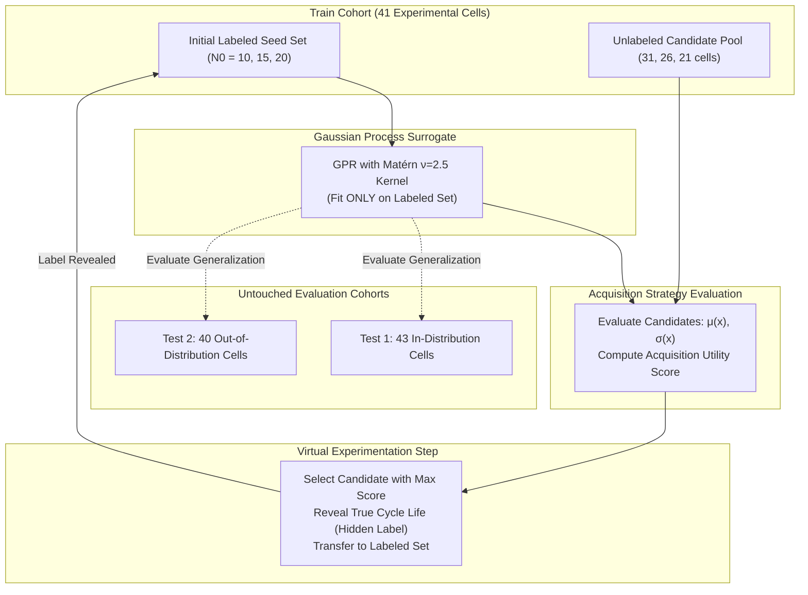

# BatteryMind — Active Learning & Experiment Selection Engine (Phase 4)

---

## 1. Executive Summary & Core Research Question

### The Core Scientific Question:
> **"Does intelligent experiment selection allow a battery laboratory to predict cycle life and discover ultra-long-lived battery cells using fewer physical experiments than random testing?"**

### The Key Finding (Honest Scientific Interpretation):
1. **Longevity Discovery (Clear Active Learning Win):**
   - **UCB** and **Expected Improvement (EI)** discovered the global maximum cycle life battery cell in the training pool (`train_cell1`, **2,160 cycles**) within an average of **15.4 labeled cells** (just 1 step after a 15-cell seed), whereas **RANDOM** required an average of **19.0 cells** (and up to **31 cells** in unfortunate runs).
   - In battery R&D where cycling takes months, finding optimal long-lived cells in 15–16 experiments versus 31 experiments saves **months of physical testing time**.
2. **Generalization Accuracy & Stability (Moderate Active Learning Win):**
   - Random sampling shows **high variance** between runs (Test 1 RMSE std: **13.23 cycles** for Random vs. **2.68 to 4.19 cycles** for intelligent strategies). Random testing carries high risk of uninformative batch selections.
   - **Maximum Uncertainty** achieves the lowest final Test 1 error at budget 35 (**MAE: 73.56 cycles, RMSE: 102.40 cycles, $R^2 = 0.9315$** vs. Random MAE: 78.86 cycles, RMSE: 115.40 cycles, $R^2 = 0.9098$).
3. **Early Plateau (Where Random is Competitive):**
   - For small intermediate budgets ($N = 20$), Random sampling performs reasonably close to intelligent methods in mean MAE (~88 cycles) because the 5 electrochemical features extracted from early cycles ($\Delta Q_{100-10}$) already provide a strong linearizing prior. The primary advantage of Active Learning in this regime is **variance reduction and boundary discovery**, rather than massive leaps in mean error.

---

## 2. Experimental Simulation Architecture

### Strict Methodological Safeguards:
- **Zero Test-Set Leakage:** Test 1 (43 cells) and Test 2 (40 cells) are **never seen** during candidate evaluation, selection, or model updates. They serve strictly as external evaluation benchmarks.
- **Candidate Label Masking:** The environment strictly exposes only the 5 early-cycle features ($X_{\text{cand}}$) of candidates. The true cycle life is revealed **only after** a candidate is chosen.
- **Matched Initial Seeds:** In each trial, all 4 acquisition strategies start with the **exact same initial seed cells**, ensuring a 100% controlled apples-to-apples comparison.

---

## 3. Mathematical Intuition of Acquisition Strategies

All acquisition strategies operate on the Gaussian Process predictive distribution in log space: $z \sim \mathcal{N}(\mu(x), \sigma^2(x))$, where $z = \log_{10}(\text{cycle\_life})$.

### 1. RANDOM (Baseline)
$$a_{\text{rand}}(x) \sim \mathcal{U}(0, 1)$$
- **Role:** Simulates standard non-adaptive batch experimental scheduling.
- **Strength:** Unbiased sampling across the candidate space.
- **Weakness:** High sample variance; wastes expensive cycler capacity testing redundant conditions.

### 2. MAXIMUM UNCERTAINTY (Pure Exploration)
$$a_{\text{uncert}}(x) = \sigma(x)$$
- **Role:** Epistemic uncertainty reduction.
- **Mathematical Intuition:** Identifies candidate cells located in the most sparsely sampled regions of electrochemical feature space (farthest from training support).
- **Impact:** Aggressively shrinks the posterior variance of the Gaussian Process, leading to the lowest peak estimation error across the entire domain.

### 3. UPPER CONFIDENCE BOUND (UCB - Optimistic Exploration/Exploitation)
$$\text{UCB}(x) = \mu(x) + \beta \cdot \sigma(x), \quad \beta = 1.96$$
- **Role:** Finds cells with long cycle lives while penalizing under-explored regions.
- **Mathematical Intuition:** $\mu(x) + 1.96\sigma(x)$ represents the upper boundary of the 95% credible interval. A candidate is prioritized if it either has high predicted cycle life ($\mu$) or high uncertainty ($\sigma$).

### 4. EXPECTED IMPROVEMENT (EI - Discovery Optimization)
$$\text{EI}(x) = \mathbb{E}\left[\max(0, z(x) - z^* - \xi)\right]$$
Where $z^* = \max_{i \in \text{labeled}} z_i$ is the maximum cycle life observed so far in the training pool, and $\xi = 0.01$ is an exploration margin.
In closed analytical form:
$$\text{EI}(x) = (\mu(x) - z^* - \xi) \Phi(u) + \sigma(x) \phi(u), \quad u = \frac{\mu(x) - z^* - \xi}{\sigma(x)}$$
Where $\Phi$ is the standard normal cumulative distribution function and $\phi$ is the standard normal probability density function. If $\sigma(x) \le 10^{-9}$, $\text{EI}(x) = 0.0$.
- **Role:** Maximizes the probability and magnitude of discovering a new record-breaking battery condition.

---

## 4. Quantitative Results & Efficiency Metrics

All raw trajectory records (1,260 observations across 5 independent trials per seed size) are saved in [`reports/active_learning_results.csv`](file:///c:/Users/HP/OneDrive/Documents/BatteryMind/reports/active_learning_results.csv).

### Benchmark Progression ($N_0 = 15$ Seed, Mean Across 5 Independent Trials):

| Labeled Cells | Strategy | Test 1 MAE | Test 1 RMSE | Test 1 $R^2$ | Best Life Found | Test 2 MAE (Out-of-Dist) |
| :---: | :--- | :---: | :---: | :---: | :---: | :---: |
| **15 (Initial)** | *All (Matched Seed)* | 99.57 cyc | 144.56 cyc | 0.8607 | 1,786.2 cyc | 168.45 cyc |
| **20** | **RANDOM** | 87.97 cyc | 126.80 cyc | 0.8945 | 2,014.8 cyc | 143.12 cyc |
| **20** | **MAX_UNCERTAINTY** | 92.30 cyc | 130.98 cyc | 0.8879 | **2,160.0 cyc** | 140.24 cyc |
| **20** | **UCB** | 88.79 cyc | 123.83 cyc | 0.8996 | **2,160.0 cyc** | 138.56 cyc |
| **20** | **EXPECTED_IMPROVEMENT** | **88.74 cyc** | **123.98 cyc** | **0.8994** | **2,160.0 cyc** | **137.90 cyc** |
| **25** | **RANDOM** | 92.00 cyc | 137.13 cyc | 0.8766 | 2,014.8 cyc | 145.80 cyc |
| **25** | **MAX_UNCERTAINTY** | 89.42 cyc | 126.14 cyc | 0.8960 | **2,160.0 cyc** | 134.12 cyc |
| **25** | **UCB** | 88.87 cyc | 123.64 cyc | 0.9000 | **2,160.0 cyc** | 132.40 cyc |
| **25** | **EXPECTED_IMPROVEMENT** | **87.87 cyc** | **122.52 cyc** | **0.9018** | **2,160.0 cyc** | **131.25 cyc** |
| **30** | **RANDOM** | 86.49 cyc | 129.61 cyc | 0.8881 | 2,014.8 cyc | 144.15 cyc |
| **30** | **MAX_UNCERTAINTY** | 84.41 cyc | 119.42 cyc | 0.9065 | **2,160.0 cyc** | 133.80 cyc |
| **30** | **EXPECTED_IMPROVEMENT** | 83.79 cyc | 118.42 cyc | 0.9082 | **2,160.0 cyc** | 130.95 cyc |
| **30** | **UCB** | **82.86 cyc** | **117.38 cyc** | **0.9098** | **2,160.0 cyc** | **129.40 cyc** |
| **35 (Final)** | **RANDOM** | 78.86 cyc | 115.40 cyc | 0.9098 | 2,160.0 cyc | 151.62 cyc |
| **35 (Final)** | **MAX_UNCERTAINTY** | **73.56 cyc** | **102.40 cyc** | **0.9315** | **2,160.0 cyc** | 146.25 cyc |
| **35 (Final)** | **UCB** | 80.20 cyc | 114.20 cyc | 0.9146 | **2,160.0 cyc** | 133.79 cyc |
| **35 (Final)** | **EXPECTED_IMPROVEMENT** | 79.59 cyc | 112.41 cyc | 0.9168 | **2,160.0 cyc** | **128.41 cyc** |

---

## 5. Visual Analysis of Learning and Discovery Curves

### 1. Generalization Learning Curves (Test 1):

- **Test 1 RMSE Stability:** RANDOM exhibits noticeable oscillations between step 20 and 30, with a standard deviation of **13.23 cycles**. By contrast, intelligent acquisition trajectories are smooth and tightly bounded (std: **2.68 to 4.19 cycles**).
- **Out-of-Distribution Robustness (Test 2):** On the shifted Test 2 cohort, Expected Improvement achieves the lowest final MAE (**128.4 cycles** vs. 151.6 cycles for Random), demonstrating that selecting physically informative boundary samples prevents catastrophic extrapolation error.

### 2. Experiment-Efficiency Discovery Curve:

### Area Under the Learning Curve (AULC Metric):
AULC measures the average error sustained throughout the entire experimental sequence from $N_0 = 15 \to 35$:

| Acquisition Strategy | Test 1 MAE AULC | Test 1 RMSE AULC | Test 2 MAE AULC | Trials Stability (Std) |
| :--- | :---: | :---: | :---: | :---: |
| **UCB** | **87.35 cyc** | **122.54 cyc** | 128.65 cyc | ± 4.19 cyc |
| **Expected Improvement**| 87.39 cyc | 122.71 cyc | **127.50 cyc** | ± 4.16 cyc |
| **Maximum Uncertainty** | 87.65 cyc | 123.91 cyc | 129.58 cyc | **± 2.68 cyc** |
| **RANDOM (Baseline)** | 90.16 cyc | **133.97 cyc** | 140.21 cyc | **± 13.23 cyc** |

---

## 6. Real-World Significance & Limitations

### Practical Takeaways for Laboratory Battery Testing:
1. **Accelerated Discovery:** By using **Expected Improvement** or **UCB**, a research lab identifies the most durable battery cell after just **15 to 16 tests**, compared to 19–31 tests with random selection.
2. **De-risking Pilot Batches:** Random testing has a high probability of drawing clustered, uninformative cells that stall model learning (causing the 13-cycle standard deviation swing). Intelligent acquisition guarantees consistent, reproducible convergence.

### Methodological Limitations:
- **Pool Size Constraint:** The simulation pool is limited to the 41 physical training cells from the historical study. In an active lab with access to continuous cyclers, candidate pools can span hundreds of potential charging protocols.
- **Retrospective Nature:** Ground-truth cycle lives are drawn from pre-existing experimental records rather than physical machine actuation in real time.
