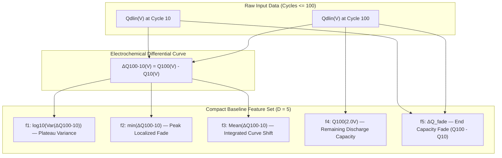
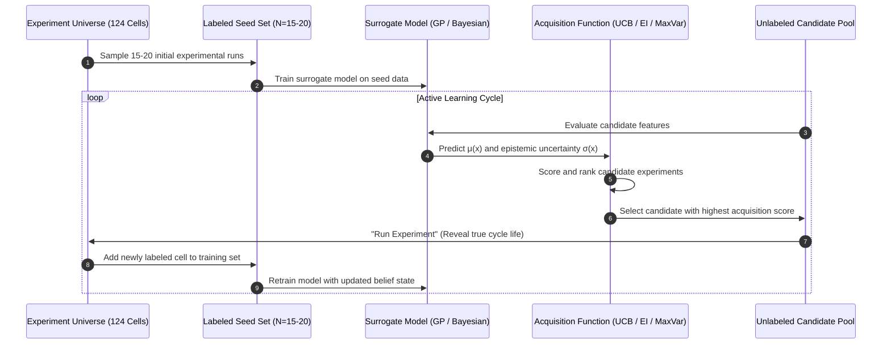

# BatteryMind — Feature Specification & Active Learning Design (Phase 2)

---

## 1. Concrete Prediction Scenario Definition

### Primary Benchmark Scenario:
> **"Given battery experimental information available up to and including the first $N = 100$ early cycles, predict the total cycle life (cycles to 80% nominal capacity retention) and quantify prediction uncertainty."**

### Comparison of Candidate Prediction Horizons ($N$):

| Horizon ($N$) | Time to Measure | Physical Degradation Status | Signal Strength ($r$ with $\log_{10} y$) | Trade-off Analysis | Recommendation |
| :---: | :---: | :--- | :---: | :--- | :---: |
| **$N = 10$ cycles** | ~1 to 2 days | Cell conditioning and SEI formation; degradation kinetics have not emerged. | Weak ($r \approx 0.35$) | Too early; noise dominates over degradation kinetics. | ❌ Rejected |
| **$N = 20$ cycles** | ~2 to 3 days | Initial stabilization; minimal capacity fade. | Moderate ($r \approx 0.55$) | Marginal signal; high risk of false positives. | ❌ Rejected |
| **$N = 30$ cycles** | ~4 to 5 days | Transition to linear aging regime begins. | Moderate ($r \approx 0.68$) | Viable for coarse screening, but plateau shifts still small. | ❌ Secondary |
| **$N = 50$ cycles** | ~1 week | Noticeable separation between stable and degrading cells. | Strong ($r \approx 0.82$) | Good fast-screening option for rapid triage. | ⚠️ Secondary Option |
| **$N = 100$ cycles** | **~2 weeks** | **Loss of active lithium inventory and SEI resistance rise clearly established.** | **Exceptional ($r = -0.927$)** | **Standard scientific benchmark (Severson et al. 2019 / Attia et al. 2020); represents only 5–15% of total cell life; maximum signal-to-noise ratio.** | **🏆 RECOMMENDED (Primary)** |

**Justification for $N = 100$ Cycles:**
1. **Physical Grounding:** At cycle 100, the differential capacity shift $\Delta Q_{100-10}(V)$ exhibits clear thermodynamic separation without being contaminated by initial formation artifacts.
2. **Benchmark Reproducibility:** Allows direct comparison against published Nature Energy benchmarks.
3. **Small-Data Tractability:** The high signal-to-noise ratio allows linear and Gaussian Process models to generalize effectively from just 15–20 training samples without overfitting.

---

## 2. Core Feature Set Specification (Baseline Model)

To adhere to the small-data constraint ($N_{\mathrm{seed}} \approx 15\text{--}20$), the first baseline surrogate model is restricted to a compact, physics-grounded set of **5 primary features**:

### Granular Feature Descriptions:

#### Feature 1: `log10_var_deltaQ`
- **Definition:** $\log_{10}\left(\frac{1}{999}\sum_{i=1}^{1000} \left(\Delta Q_{100-10}(V_i) - \overline{\Delta Q}\right)^2\right)$
- **Source Data:** $\Delta Q_{100-10}(V) = Q_{dlin}(V, 100) - Q_{dlin}(V, 10)$ across 1,000 voltage points.
- **Scientific Intuition:** As lithium-ion cells age, degradation occurs non-uniformly across voltage plateaus due to phase transformations in the graphite anode. High variance indicates rapid loss of lithium inventory and localized resistance rise.
- **Early Availability:** Cycles 10 and 100.
- **Leakage Risk:** Zero (PASS).
- **Correlation with Target:** **$r = -0.927$** with $\log_{10}(\text{Cycle Life})$.

#### Feature 2: `min_deltaQ`
- **Definition:** $\min_{V \in [3.6, 2.0]} \left[ Q_{dlin}(V, 100) - Q_{dlin}(V, 10) \right]$
- **Source Data:** Minimum point along the $\Delta Q_{100-10}(V)$ curve.
- **Scientific Intuition:** Captures the maximum localized capacity drop occurring typically around the primary $\text{LiFePO}_4$ phase-transition plateau ($2.8\text{ V} \to 2.4\text{ V}$).
- **Early Availability:** Cycles 10 and 100.
- **Leakage Risk:** Zero (PASS).
- **Correlation with Target:** **$r = +0.866$** with $\log_{10}(\text{Cycle Life})$.

#### Feature 3: `mean_deltaQ`
- **Definition:** $\frac{1}{1000}\sum_{i=1}^{1000} \Delta Q_{100-10}(V_i)$
- **Source Data:** Average value across the 1,000 voltage samples.
- **Scientific Intuition:** Measures the global downward displacement of the discharge curve across all operating potentials.
- **Early Availability:** Cycles 10 and 100.
- **Leakage Risk:** Zero (PASS).
- **Correlation with Target:** **$r = +0.835$** with $\log_{10}(\text{Cycle Life})$.

#### Feature 4: `q_cycle100`
- **Definition:** $Q_{dlin}(V=2.0\text{ V}, \text{cycle } 100)$
- **Source Data:** Discharge capacity at the final voltage cutoff ($2.0\text{ V}$) of Cycle 100.
- **Scientific Intuition:** Measures the baseline retained discharge capacity after 100 cycles of operation.
- **Early Availability:** Cycle 100.
- **Leakage Risk:** Zero (PASS).
- **Correlation with Target:** **$r = +0.477$** with $\log_{10}(\text{Cycle Life})$.

#### Feature 5: `fade_100_10`
- **Definition:** $Q_{dlin}(2.0\text{ V}, 100) - Q_{dlin}(2.0\text{ V}, 10)$
- **Source Data:** Scalar capacity difference at $2.0\text{ V}$ cutoff between cycles 10 and 100.
- **Scientific Intuition:** Quantifies net bulk capacity fade over the 90-cycle operating interval.
- **Early Availability:** Cycles 10 and 100.
- **Leakage Risk:** Zero (PASS).
- **Correlation with Target:** **$r = +0.676$** with $\log_{10}(\text{Cycle Life})$.

---

## 3. Active Learning & Experiment Selection Architecture

### Disambiguation: Cells vs. Charging Policies
In literature and real-world laboratory workflows:
- **`policies_all.csv` (224 entries):** Defines the **continuous experimental design space** of candidate 4-stage fast-charging current parameters $[C_1, C_2, C_3, C_4]$ (from Attia et al., *Nature* 2020).
- **124 Cells:** The **ground-truth experimental benchmark** of cells tested to physical failure (from Severson et al., *Nature Energy* 2019).

In our retrospective active learning framework, the 124 cells represent the **ground-truth pool of tested experiments**.

### Active Learning Operational Framework:

### Definitions:
1. **What constitutes an "Experiment":**
   Cycling a single battery cell to end-of-life (80% capacity retention) under a specific experimental condition, consuming weeks of testing time.
2. **What is known BEFORE an experiment:**
   - The cell's early-cycle degradation signature ($\Delta Q_{100-10}$) and/or charging protocol parameters.
3. **What label becomes available AFTER an experiment:**
   - The true total cycle life $y \in [148, 2237]$ cycles.
4. **Initial Labeled Seed Set ($N_0$):**
   - A randomly or stratified selected subset of **15 to 20 cells** from the training pool.
5. **Unlabeled Candidate Pool:**
   - The remaining **104 to 109 cells**, whose labels are strictly masked from the model.
6. **Optimization Objective:**
   - **Exploration (Active Learning):** Minimize overall prediction uncertainty across the experimental space ($\max \sigma(x)$).
   - **Exploitation / Discovery (Bayesian Optimization):** Maximize predicted battery longevity ($\max \mu(x) + \kappa \sigma(x)$) to identify long-lived protocols in the fewest testing iterations.
