# BatteryMind — Data Leakage & Integrity Analysis (Phase 2)

---

## 1. Principles of Leakage Prevention in Battery Informatics

Battery degradation is a strictly temporal physical process. In commercial and laboratory applications, early-prediction models are deployed when a cell has only experienced a fraction of its total lifetime (e.g., $N = 100$ cycles out of $1,000+$ cycles).

Data leakage occurs if the model receives any signal—direct or indirect—that would not be physically accessible at the chosen prediction cutoff $N$:

```mermaid
flowchart LR
    subgraph Observable["PHYSICALLY OBSERVABLE (Cycles 1 to N)"]
        A["Charging Policy (known at t=0)"]
        B["Cycles 2 to N Voltage Curves Qdlin(V)"]
        C["Early Capacity Fade Q_N - Q_10"]
    end
    subgraph Cutoff["PREDICTION HORIZON CUTOFF (Cycle N)"]
        D["MODEL INFERENCE & UNCERTAINTY"]
    end
    subgraph Unobservable["STRICTLY UNOBSERVABLE / FORBIDDEN LEAKAGE"]
        E["Measurements from Cycles > N"]
        F["Knee-point or End-of-Life (EOL) Cycle"]
        G["Global Dataset Statistics (Mean/Scaling of Pool)"]
        H["Final Discharge Capacity < 0.88 Ah"]
    end
    Observable --> D
    D -.->|Forbidden| Unobservable
```

---

## 2. Granular Feature Leakage Audit (PASS / FAIL)

Every proposed candidate feature is evaluated against five strict non-leakage criteria:
1. **$C_1$ (Temporal Horizon):** Uses only data from cycles $\le N$ (where $N = 100$).
2. **$C_2$ (Target Independence):** Does not incorporate ground-truth cycle life ($y$) or EOL thresholds.
3. **$C_3$ (No Future Lookahead):** Does not query internal resistance, temperature, or capacity after cycle $N$.
4. **$C_4$ (Split Isolation):** Computed strictly on a per-cell basis without using information from other cells.
5. **$C_5$ (Normalization Isolation):** Any future scaling parameters (mean, variance) are fit strictly on the initial seed training pool.

| Candidate Feature / Processing Step | Evaluation Details | Decision |
| :--- | :--- | :---: |
| **$\log_{10}(\mathrm{Var}(\Delta Q_{100-10}))$** | Computed strictly using $Q_{dlin}(V)$ from Cycle 100 and Cycle 10. Contains zero future-cycle data and zero target information. Computed independently per cell. | **✅ PASS** |
| **$\min(\Delta Q_{100-10}(V))$** | Minimum value of $[Q_{100}(V) - Q_{10}(V)]$. Derived strictly from cycles 10 and 100. Computed independently per cell. | **✅ PASS** |
| **$\mathrm{Mean}(\Delta Q_{100-10}(V))$** | Integrated difference curve over the 1,000 voltage points between cycles 10 and 100. Uses only early data. | **✅ PASS** |
| **$\Delta Q_{100-10}^{\mathrm{end}}$ (End Capacity Fade)** | $Q_{100}(2.0\text{V}) - Q_{10}(2.0\text{V})$. Uses only the 2.0V cutoff measurement at cycles 10 and 100. | **✅ PASS** |
| **$\mathrm{Slope}_{100-10}$ (Degradation Rate)** | Linear slope $\frac{Q_{100} - Q_{10}}{90}$. Strictly within early window ($n \le 100$). | **✅ PASS** |
| **$Q_{100}$ (Cycle 100 Capacity)** | Discharge capacity measured at cycle 100. Available at prediction point $N=100$. | **✅ PASS** |
| **Protocol Currents $[C_1, C_2, C_3, C_4]$** | Defined prior to cycling during experimental setup ($t = 0$). Zero leakage. | **✅ PASS** |
| **$\Delta Q_{200-10}$ or Cycle 200 Features** | ❌ **FORBIDDEN:** Uses measurements from Cycle 200. Not available at $N=100$. Cells with cycle life $< 200$ would have undefined values or fail before measurement. | **❌ FAIL** |
| **Cycle to 95% or 90% Capacity Drop** | ❌ **FORBIDDEN:** Many long-lived cells do not reach 90% capacity by cycle 100. Using this requires monitoring past cycle 100. | **❌ FAIL** |
| **Global Feature Scaling on All 124 Cells** | ❌ **FORBIDDEN:** Fitting a `StandardScaler` across all 124 cells leaks candidate pool distribution into the training set. | **❌ FAIL** |
| **Target-Encoded Policy Statistics** | ❌ **FORBIDDEN:** Encoding charging policy strings with the average cycle life of all cells sharing that policy leaks the target. | **❌ FAIL** |

---

## 3. Strict Preprocessing Boundaries for Phase 3+

To guarantee 100% scientific reproducibility and zero leakage throughout the remainder of the project:

1. **Pipeline Encapsulation:**
   All normalization, feature scaling, and imputation must be encapsulated inside a Scikit-Learn `Pipeline` that calls `.fit()` **only on the current labeled training pool**.
2. **Offline Active Learning Isolation:**
   When simulating the candidate experiment pool in Phase 3/4, the ground-truth targets ($y$) of the candidate cells must remain **strictly masked** in memory until an experiment is explicitly acquired.
3. **Validation Strategy:**
   Model performance must be measured on held-out test splits (`test1`, `test2`) whose labels are never exposed to the surrogate model during seed training or active learning iterations.
